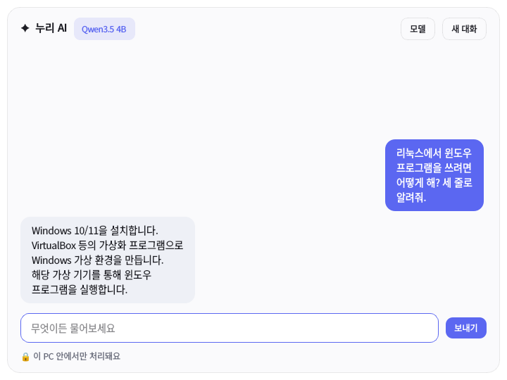
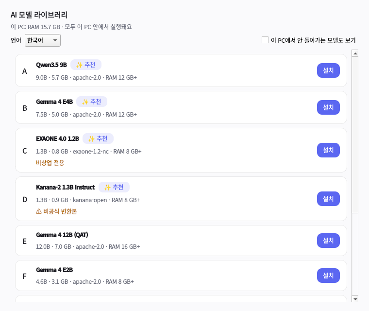

# Nuri OS (가칭)

KDE Plasma 데스크톱에 **PC 안에서만 동작하는 AI 비서**를 넣은 리눅스 배포판이에요.
Fedora Kinoite(atomic KDE)를 기반으로 하고, OS 전체를 컨테이너 이미지 하나로 만들어 배포해요.

| AI 패널 (`Meta+Space`) | 모델 라이브러리 |
|---|---|
|  |  |

> 이름 "Nuri"는 임시 코드네임이에요. 공개 전에 상표 검색을 하고 확정하세요.
> 이름은 `build_files/20-branding.sh`, `Containerfile`, `nuri-ai`의 문구에 있어요.

## 지금 되는 것

| 기능 | 상태 |
|---|---|
| Fedora 45 Kinoite 기반 OS 이미지 빌드 (`bootc container lint` 통과) | 동작 확인 |
| 로컬 AI 엔진: llama.cpp 직접 빌드 (모든 x86-64 CPU 변형 + Vulkan GPU), 127.0.0.1 전용 | 동작 확인 |
| `nuri-ai` CLI: PC 사양·언어별 추천 (A, B, C…, ✨), 고정된 파일·SHA-256 검증 설치, 이어받기 | 동작 확인 |
| 긴 대화: 전체 기록은 디스크에, 오래된 대화는 "사실 메모"로 요약 | 동작 확인 (Qwen3.5 4B) |
| **누리 AI 패널** (GUI): 스포트라이트형 대화창, 실시간 답변, 다크 모드 | 화면 렌더링 확인 |
| **모델 라이브러리** (GUI): 언어 선택, ✨ 추천, 비상업·비공식 경고, 설치 진행 막대 | 화면 렌더링 확인 |
| **Dolphin 우클릭 메뉴**: 텍스트 파일 요약·설명·번역 | 동작 확인 (GUI 테스트), 실기 미검증 |
| **맥 느낌 데스크톱**: 상단 바(전역 메뉴·한/A 표시·시계), 가운데 떠 있는 독, 왼쪽 창 버튼, 자체 배경화면(밝게/어둡게) | 작성됨, 실기 부팅 미검증 |
| **한글 입력** (fcitx5-hangul, 한/영 키 또는 Ctrl+Space) | 설치됨, 실기 미검증 |
| Wine, winetricks, NTFS/exFAT, SMB | 설치됨 |
| 첫 부팅 시 Flatpak 앱 설치 (Bottles, Steam, LibreOffice, LocalSend, Firefox) | 작성됨, 실기 미검증 |
| 자동 업데이트 (받아 두고 재부팅 때 적용, 롤백 가능) | 작성됨, 실기 미검증 |
| 설치용 ISO (bootc-image-builder) | 작성됨, 미검증 |

## 구조

```
Containerfile                 OS 이미지 정의: llama.cpp 빌드 단계 + Fedora Kinoite 45 단계
build_files/
  build-llama.sh              llama.cpp 서버 빌드 (CPU 전 변형 + Vulkan, ROCm 없이)
  10-packages.sh              추가 패키지 (PyQt6, fcitx5 한글, wine, …)
  20-branding.sh              OS 이름 표시
  30-services.sh              서비스 활성화, 아이콘 캐시
system_files/                 이미지에 그대로 복사되는 파일
  usr/lib/nuri/nuri_ai.py     AI 핵심 로직 (추천, 설치·검증, 대화·기억) - 표준 라이브러리만 사용
  usr/lib/nuri/nuri_assistant.py  GUI: AI 패널, 모델 라이브러리, 파일 작업 (PyQt6)
  usr/bin/nuri-ai, nuri-assistant 실행 파일
  usr/share/applications/     누리 AI 실행 항목 (Meta+Space)
  usr/share/kio/servicemenus/ Dolphin 우클릭 "누리 AI" 메뉴
  usr/share/plasma/look-and-feel/org.nuri.desktop/  데스크톱 배치·기본 테마
  usr/share/wallpapers/Nuri/  자체 제작 배경화면 (tools/make_wallpaper.py로 생성)
  etc/xdg/                    KDE 기본값 (창 버튼 위치, 입력기, 단축키, 잠금화면)
  usr/lib/systemd/            nuri-ai.service(사용자), nuri-flatpak-setup.service
  usr/share/nuri/models.json  고정된 모델 레지스트리
registry/models.src.json      사람이 고르는 모델 목록과 언어별 추천 순위
tools/                        레지스트리 고정, 배경화면 생성, 데스크톱 스크린샷 도구
iso/config.toml               설치 ISO 설정
tests/                        CLI 테스트 + GUI 테스트(화면 없이 렌더링)
```

## 빌드

필요한 것: Linux, `podman`(권장) 또는 `docker`, 디스크 여유 40GB 이상.

```bash
make test                # 단위 테스트 + GUI 테스트 (PyQt6 있으면)
make build               # OS 이미지 빌드 → localhost/nuri:dev
make run                 # 이미지 안에서 셸 열기
make iso                 # 설치용 ISO → output/ (podman, root 필요)
```

회사망처럼 HTTPS를 가로채는 프록시 뒤에서 빌드하면 Fedora 저장소 연결이 실패해요.
그럴 때만 `make build EXTRA_CA=/path/to/proxy-ca.pem`을 쓰세요.
이 인증서는 빌드 중에만 쓰이고 완성된 이미지에는 남지 않아요.

## 로컬 AI 사용법 (설치된 OS에서)

- **`Meta+Space`**(윈도우 키 + 스페이스): 누리 AI 패널을 열고 닫아요. 처음이면 모델 라이브러리가 열려요.
- 독의 누리 AI 아이콘, 또는 앱 메뉴의 "누리 AI → 모델 라이브러리"
- Dolphin에서 텍스트 파일 우클릭 → **누리 AI → 요약하기 / 설명 듣기 / 번역하기**

터미널에서는:

```bash
nuri-ai list                       # 이 PC에 맞는 모델 (시스템 언어 기준)
nuri-ai list --lang en             # 다른 언어 기준으로 보기
nuri-ai install qwen3.5-4b         # 라이선스 확인 후 내려받기 + 검증
nuri-ai use exaone-4.0-1.2b        # 설치된 모델 중 전환
nuri-ai chat                       # 대화 (Ctrl-D 종료)
nuri-ai ask "이 문장 요약해줘: …"   # 한 번 묻기 (단축키, 스크립트용)
nuri-ai status
```

- AI 서버는 `127.0.0.1`에만 열려서 네트워크의 다른 기기가 접근할 수 없어요.
- 모델, 설정, 대화 기록은 모두 `~/.local/share/nuri`, `~/.config/nuri`에 있어요.
- 인터넷을 쓰는 순간은 모델을 내려받을 때뿐이에요.
- 서버 설정(컨텍스트 길이, GPU 사용 등)은 `/usr/share/nuri/ai.env.example`을 참고하세요.
  GPU를 쓰려면 `NURI_EXTRA_ARGS="--n-gpu-layers 99"`를 넣으면 Vulkan으로 가속돼요(AMD·Intel·NVIDIA).

## 데스크톱

첫 로그인 때 `org.nuri.desktop` 배치가 적용돼요.

- 상단 바: 앱 메뉴(누리 아이콘), 현재 앱의 전역 메뉴, 한/A 입력기 표시, 트레이, 날짜·시계
- 하단 독: 가운데 정렬, 떠 있고, 창이 겹치면 비켜요. 파일·Firefox·누리 AI·터미널·Discover·설정·휴지통
- 창 버튼: 왼쪽에 닫기·최소화·최대화
- 배경화면: 직접 생성한 그라데이션(밝게/어둡게). 애플 로고·아이콘·이름은 쓰지 않아요.

모든 설정은 시스템 설정에서 바꿀 수 있어요. 기본값은 `system_files/etc/xdg/`와
`look-and-feel/org.nuri.desktop/`에 있어요.

## 모델 레지스트리

`registry/models.src.json`에 모델과 언어별 추천 순위를 적고 `make registry`를 실행하면
`system_files/usr/share/nuri/models.json`이 만들어져요. 각 모델은 정확한 저장소 커밋,
파일 이름, SHA-256으로 고정되어서, 원본 저장소가 바뀌어도 검증되지 않은 파일은 설치되지 않아요.

| 필드 | 뜻 |
|---|---|
| `min_ram_gb` | OS·데스크톱까지 포함한 PC 전체 RAM 기준 |
| `recommend` | 언어별 추천 순위 (✨ 표시). 예: `{"ko": 1}` |
| `commercial` | `yes` / `no` / `unverified`. LICENSE 원문을 읽은 뒤에만 yes/no |
| `trust` | `official`(제작사) / `trusted-quant`(unsloth, bartowski 등) / `repackaged`(제3자 변환, 경고 표시) |

현재 14개 모델이 들어 있어요. 라이선스 조사 결과는 저장소의
`reports/로컬 LLM 라이선스와 등급별 추천.md`를 보세요. 대부분 `commercial: unverified`예요.

## 업데이트 방식

설치된 PC는 `ghcr.io/OWNER/nuri:latest` 이미지를 따라가요(`iso/config.toml`의 `OWNER`를
실제 GitHub 계정으로 바꾸세요). `rpm-ostreed-automatic.timer`가 새 이미지를 받아 두고,
다음 재부팅 때 적용해요. 문제가 생기면 부팅 메뉴에서 이전 버전을 고르거나
`sudo bootc rollback`으로 되돌릴 수 있어요.

## 알려진 한계

- **데스크톱 배치와 테마는 실제 화면으로 확인하지 못했어요.** Plasma 6.8의 KWin은 GPU 렌더링 장치가
  있어야 실행되는데 개발 환경에 없었어요. GPU가 있는 PC에서 `tools/desktop-screenshot.sh`로
  확인할 수 있어요 (스크립트 맨 위 사용법 참고).
- `kcm-fcitx5`(시스템 설정 안의 입력기 화면)는 지금 Fedora 45에서 설치가 안 돼서(패키지 의존성 문제)
  별도 설정 도구 `fcitx5-configtool`을 넣었어요.
- 1B급 모델(EXAONE 4.0 1.2B)은 메모가 있어도 이전 내용을 답에 활용하지 못했어요. 같은 테스트에서
  Qwen3.5 4B는 성공했어요. 긴 대화가 중요하면 8GB 기기에서도 3~4B급을 기본으로 두는 게 좋아요.
- 생각(reasoning) 모델은 기본적으로 생각 모드를 끄고 써요(`NURI_THINK=1`로 켬). 켜 두면 CPU에서
  한 턴에 수 분이 걸렸어요.
- 측정 환경(클라우드 컨테이너, CPU 4코어)에서 Qwen3.5 4B는 생성 약 3.4토큰/초, 한 턴 약 17초였어요.
  일반 PC에서는 더 빠를 수 있지만 아직 실기 측정은 없어요.
- Vulkan GPU 가속은 빌드에 포함됐지만 GPU가 없는 환경이라 실제 가속은 측정하지 못했어요.
- Kanana 한국어 모델은 공식 GGUF가 없어서 제3자 변환본을 가리켜요(⚠ 경고 표시).
- NVIDIA 독점 드라이버는 넣지 않았어요(오픈소스 Mesa 드라이버는 기본 포함).
- ISO 설치, 첫 부팅 앱 설치, 자동 업데이트는 실제 PC나 VM에서 아직 검증하지 않았어요.
- GitHub Actions 워크플로는 `distro/`가 독립 저장소가 되어야 실행돼요.

## 라이선스

이 저장소의 코드는 Apache License 2.0, 배경화면은 CC BY 4.0이에요. 함께 빌드되는 llama.cpp는
MIT 라이선스예요(`/usr/libexec/nuri-llama/LICENSE`). 각 AI 모델은 각자의 라이선스를 따르고,
`nuri-ai install`이 설치 전에 그 라이선스를 보여 주고 동의를 받아요.
